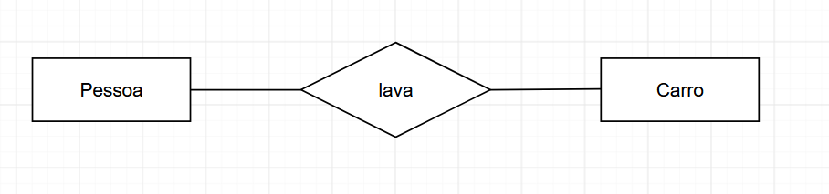

# Modelagem de dados:
Modelo conceitual para descrever entidades(objetos), seus atributos e como eles se relacionam.

## Diagrama entidade relacionamento (DER)

    

### ENTIDADES:
Algo de importância par um usuário/organização que precisa ser representado em um bd.

- Utilização de substantivos no singular para representar as entidades.

- Os nomes e entidades/tabelas devem ser únicos dentro do esquema.

#### Instancia de entidade: 
É uma ocorrência específica de uma entidade. 

ex: Entidade:	Instancia de entidade:
	

Carro	
-----		------
fabricante	Ford
---------	-------
modelo		Fiesta
-------		------
cor		Azul
------		------
placa		AXJ-4010

### ATRIBUTOS:

-Descrevem características da entidade.
-Tipos de dados(domínio), nome e valor específico.  

Tipos de atributos:
-Simples: não possui características especiais, e indivisível
ex: nome da empresa,cpf,cnpj...
-Composto: Pode ser subdividido em outros atributos
ex: endereço: rua,cep,bairro.
-Multivalorado: Pode ter mais de um valor para um mesmo registro, utilização do * para ser identificado.
ex: telefone da empresa: podem ter vários telefones em uma empresa só
-Determinante: Define de forma única as instâncias de uma entidade. Costuma ser sublinhado para ser identificado como tal.
ex: CPNJ da empresa, código de produto...
-Identiticadores: Uma chav identifica uma instância específica na classe de entidade. 
ex: cpf, CodigoProduto, matrícula,ID_setor...

### RELACAO:
- Tabela bidimensional com características específicas, composta por linhas e colunas, crida a partir de uma  entidade. 

Características de uma relação:
- Linhas contém dados sobre instâncias de uma entidade - Registros. 
- Colunas contém dados sobre atributos da entidade- Campos.
- Cada célula da tabela armazena um único valor. 
- Todos os valores em uma coluna são do mesmo tipo (domínio)
- Cada coluna possui um nome único
- Não há duas linhas idênticas
- As relações geralmente geram tabelas no banco

### RELACIONAMENTOS:
-Entidades podem ser conectadas entre si por meio de relacionamentos. Trata-se de uma estrutura de indica a associação de elementos de uma ou mais entidades. 

#### Porque precisamos do relacionamento?
- Geralmente precisamos combinar duas ou mais  tabelas para responder as perguntas específicas do usuário. 
Representando relacionamentos: representado através de um losango. 

#### Grau do relacionamento:
-Unário
-Binário  
-Ternário

#### Efetuando Relacionamento Entre Múltiplas Tabelas
-Cada linha de dados em uma tabela deve ser identificada de forma única usando-se uma Chave Primária
-Usamos chave estrangeira para relacionar os dados entre múltiplas tabelas 
-Usamos primária de uma tabela como a chave estrangeira de outra tabela. 

### CHAVE:
- Consiste em uma ou mais colunas de uma relação cujos valores são usados para identificar de forma exclusiva uma linha ou conjunto de linha. 
-Única: Candidata, composta, primária, surrogada
- Não-unica: Estrangeira. 

#### Candidata:
- Atributo ou grupo de atributos com potencial para se tornarem uma chave primária. 
- Caso não seja utilizada como chave primária pode ser chama de chave alternativa. 
ex: Campos num matricula, cpf

#### Composta:
- Composta de dois ou mais atributos. 
- Geralmente empregada quando não é possível utilizar uma única coluna de uma tabela para identifica de forma exclusiva seus registros.

####  Primária:
-Chave escolhida para ser a chave principal da relação.
-Identifica de forma exclusiva os registros em uma tabela, não podendo ter repetição de valores nem tampouco valor nulo. 

#### Surrogada:
-Valor numérico, único, adicionado a uma relaão para servir  como chave primária
- Não possui significado para os usuários e geralmente fica escondida nas aplicações. 
-Aas chaves substitutas são frequentemente usadas no lugar de uma chave primária composta.
 
#### Estrangeira:
-Coluna de uma tabela que estabelece um relacionamento com a chave primária.
- É a partir da chave estrangeira que sabemos com qual registro em outra tabela um registro está relacionado

#### Instruções para criação de chaves primárias estrangeiras:
-Não é possível haver valores duplicados em uma chave primária
- No geral, não é possível alterar o valor de uma chave primária.
-Chaves estrangerias são baseadas em valores de dados, classificadas como ponteiros lógicos. 
- Um valor de uma chave estrangeira deve corresponder a um valor existente em uma chave primária associada (ou valor de chave única). Caso contrário, deve ser nulo (NULL)
-Uma chave estrangeira deve referenciar uma chave primária ou uma coluna de chave única. 

### Domínio:
-Definir os tipos de dados.
-Especificar valores válidos em um campo. 
ex:
		tbl_Clientes
campo		Tipo de dado 		Tamanho

ID_Cliente	Número			4 caracteres
Nome_Cliente	Caractere		40 caracteres
CPF_Cliente	Caractere		11 caracteres
Data_Nasc	Data e hora		8 caracteres

### CARDINALIDADE:
  
-Diz respeito ao número de itens que se relacionam nas entidades. 
-Pode ser máxima ou mínima, significando respectivamente os números mínimo e máximo d instâncias de cada entidade associadas no relacionamento

#### Cardinalidade máxima: 
Trata-se do número máximo de instâncias de entidade que podem participar em um relacionamento. Pode ser 1 ou N
#### Cardinalidade mínima: 
Número mínimo de instâncias de entidade que devem obrigatoriamente participar de um relacionamento, zero é participação opcional e um é obrigatória. 

Relacionamentos Binário um-para-um:
-Uma instância de entidade única em uma entidade está relacionada com uma instância de entidade única em outra  entidade. 
ex: professor (1,1)----- usa ----- (1,1) quadro
obs: tudo depende da regra de negócio da empresa e não somente a lógica.

Relacionamento Binário um-para-muitos:
-Uma instância de entidade única em uma classe de entidade está relacionada a muitas instâncias de entidade em outra classe de entidade. 
ex: Funcionário(1,N) ----- Trabalha ----- (1,1) Departamento. 

Relacionamento Binário muitos-para-muitos:
-Muitas instâncias em uma entidade estão relacionadas a muitas instâncias de entidade em outra entidade.
ex: Cliente(1,N)----- Adquire -----(1,N)Pacote

Desmembrando Relacionamento Muitos-para-muitos:
- Sempre que houver  um relacionamento n:m, será necessário desmembra-lo e transforma-lo em um relacionamento 1:N, porque um relacionamento n:m é muito difícil de ser implementado em um DB.
ex:

Cliente(1,N)-----Adquire-----(1,N)Pacote

		Se transforma em:

Cliente(1,1)-----Compoe-----(1,N)Cliente_Pacote  -> nova entidade
			      |
Pacote(1,N)-----Compoe---------

 
RESTRIÇÃO DE INTEGRIDADE DE DADOS:

-Manutenção e garantia da consistência e precisão dos dados(aspecto crítico)
-a integridade é atingida por meio da aplicação das restrições.

Integridade de domínio:
- Tipos de dados que são armazenados dentro da tabela, valores inseridos em uma coluna devem sempre obedecer a definição dos valores que são permitidos para essa coluna.  
-Representação interna do tipo de dado: Como esse valor é representado? é um int? float? quantas casas decimais possui?
-Presença ou não do dado: Pode ou não estar presente
-Intervalos de valores no domínio: Quais os valores dentro desse campo? há um intervalo?
-Conjuntos de valores discretos: Valores específicos que seriam aceitos naquele campo 

ex: Atributo preço do produto: valor monetário.
-Valor permitido: 25,33
-Valor não permitido:: 25 reais e 33 centavos / -32,33

Integridade Referencial:
-Assegura que valores de uma coluna em uma tabela são validos baseado nos valores em uma outra tabela relacionada. 
Ex: Se um produto de ID 523 foi cadastrado em uma tabela de Vendas, então um produto com ID 523 deve existir na tabela de Produtos relacionada.

Se um registro for excluído em uma tabela, então os registros relacionados em outras tabelas que o referenciam talvez precisem ser excluídos. o mesmo ocorre com atualização de registros. 

Integridade de Vazio:
Informa se a coluna é obrigatória ou opcional. se é possível ou não inserir um valor  na coluna. 
Ex: Uma coluna de chave primária nunca pode estar vazia, para nenhum tipo de registro.

-Valores Nulos:
Quando não há dados, é diferente de zero, espaço, string vazia ou tabulação. 
obs: Os nulos podem ser problemáticos pois indicam: 
	- O valor da coluna não é apropriado. 
	- O valor não foi inserido
	- O valor é desconhecido.

Integridade de Chave:
-Valores inseridos na coluna de chave primária, devem ser sempre únicos, dessa forma os registros serão sempre distintos
também não podendo ser nulos. 

Integridade  Definida pelo Usuário:
- Diz respeito a regras de negócio. 

DICIONÁRIO DE DADOS:
-Documento usado para armazenar informações sobre o conteúdo, formato e a estrutura  de um banco de dados, assim como os relacionamentos entre os elementos.
-Também chamado repositório de metadados.

Ex:

TABELA		RELACIONAMENTO		NOME DO RELACIONAMENTO		DESCRIÇÃO
----------------------------------------------------------------------------------
tbl_Livro	tbl_Autor		Escreve				Tabela para 
		-----------------------------------------------		cadastro dos
		tbl_Editora		Publica				livros da coleção
-----------------------------------------------------------------------------------
tbl_Autor	tbl_Livro		Escreve				Tabela para cadastro dos autores dos livros
-----------------------------------------------------------------------------------	
tbl_Editora	tbl_Livro		Publica				Cadastro de editoras
	

- Também pode ser criado um dicionário de atributos: tabela, nome da coluna, tipo de dados, comprimento, Restrições, Valor padrão, descrição... 

DEPENDENCIA FUNCIONAL:
-Seja E uma entidade, e X e Y dois atributos quaisquer de E. Dizemos que Y é funcionalmente depende de X se e somente se cada valor de X tiver associado a ele exatamente um valor de Y

	X --> Y
- X determina funcionalmente Y

ex: Oprazo de entrga de um pedido depende do número do pedido considerado:
	Numero_Pedido --> Prazo_Entrega_Pedido

urbancode  baseline --- JDBC ---- usuário de deploy

- Total: Em uma relação com uma PK composta, um atributo não chave que dependa dessa pk como um todo, e não somente de uma parte dela.   
- Parcial: Em uma relação com o PK parcia. os atributos não chave não dependem funcionalmente ed toda a PK quando esta for composta. 
- Transitiva: Quando um campo não depende diretamente da PK, mas depende de outro campo não chave. (Em caso de normalizações isso deixa de acontecer)
- Multivalorada: Quando para cada valor de um atribuo A, existe um conjunto de valores para outros atributos B e C que estão associados a ele, mas são independentes entre si. 
	A ->>B
-Onde B é a coluna que depende de A. 

NORMALIZAÇÃO:

-Anomalias de atualização são problemas qu  ocorrem em banco de dados mal planejados e não-normalizados, geralmente ocorrendo por excesso de  dados armazenados em uma mesma tabela.
-São causadas pelas dependências parciais e transitivas.
- Classificadas entre inserção, exclusão e modificação.

- Inclusão: Não deve ser possível adicionar um dado a não ser que outro dado esteja disponível
ex: Não deve ser permitido cadastrar um novo livro sem que  um autor já esteja cadastrado. 

- Exclusão: Ao excluirmos um registro, dados referentes e outra tabela são excluídos. 

ex: se excluirmos um autor, os livros desse autor devem ser excluídos também. 

- Modificação: Ao alterar o dado de uma tabela, dados em outras tabelas precisam ser alterados. 
ex: Se um código de um autor for modificado, esse código deve ser modificado na tabela de autores e na de livros também, para manter o relacionamento entre livros  e seus autores corretos. 

- Eliminando anomalias: Processo de normalização

	- Consiste num processo de análise de uma relação para assegurar que seja bem formada. 
	- Decompor relações com anomalias para produzir relações menores e bem-estruturadas.
	- Em uma relação normalizada podemos inserir, excluir ou modificar registros sem criar anomalias.

PRIMEIRA FORMA NORMAL - 1FN:

-Processo para reaprovar atributos multivalorados, o domínio de um atributo deve incluir apenas valores  indivisíveis, e o valor de qualquer atributo em uma tupla deve ser único valor do domínio desse atributo. 

Isso ocorre quando:
-Somente possuir valores atômicos
- Não há grupos de atributos repetidos.
- Existe uma chave primária
- Relação não possui atributos multivalorados ou relações aninhadas. 
ex: Um campo de Endereço possui subdomínios: Rua, Número e CEP. Esse itens devem ser separados no processo e normalização.
-Cada informação deve ser colocada em um campo diferente.

SEGUNDA FORMA NORMAL - 2FN:
- Baseado no conceito de dependência funcional total, Um esquema de relação R está na 2FN se cada atributo não-chave de R for total e funcionalmente depende da PK de R.
- Para testar a 2FN, testamos as dependências funcionais cujos atributos fazem parte da chave primária.
- Caso a Pk tenha um único atributo, esse teste não precisa ser aplicado. 

